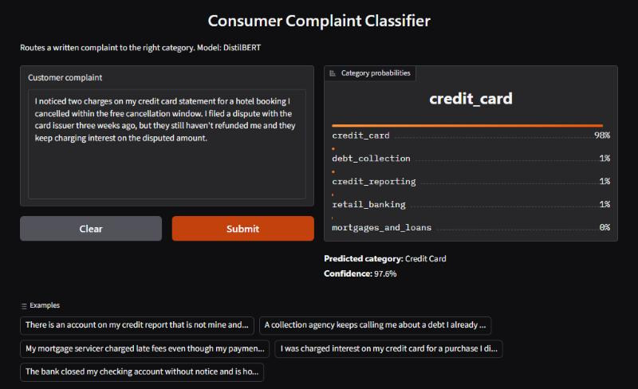
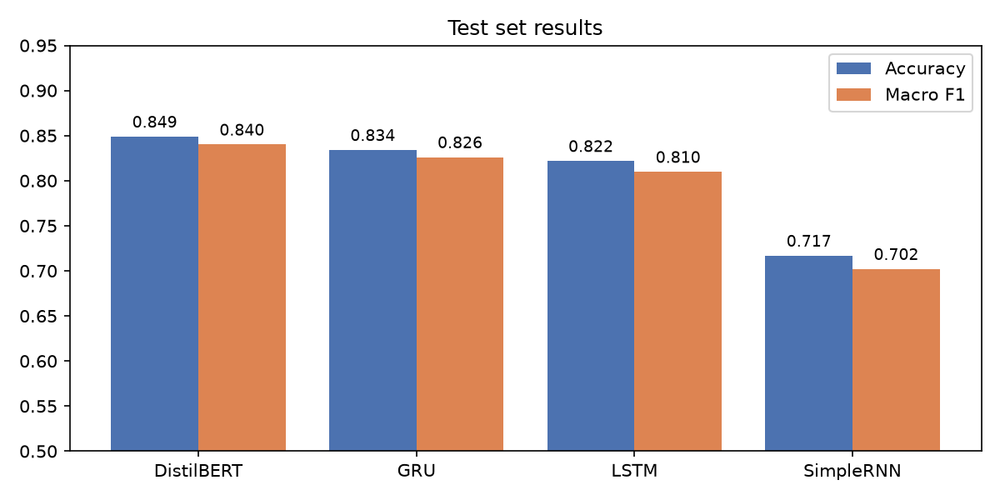
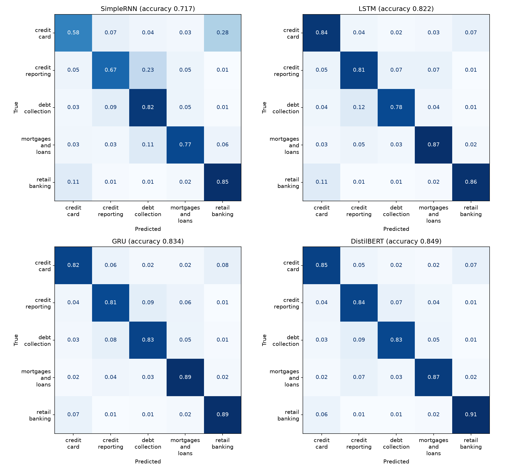

# Consumer Complaint Classification

Text classifier that reads a customer's written complaint and predicts which of **5 product categories** it belongs to: credit reporting, debt collection, mortgages and loans, credit card or retail banking.
Four models are compared on the same data: **SimpleRNN**, **LSTM** and **GRU** built from scratch in Keras, plus a fine-tuned **DistilBERT** (HuggingFace Trainer API). The best model is deployed as a **Gradio** app.



## Results (test set, 24,936 complaints)

| Model | Accuracy | Macro F1 | credit card | credit reporting | debt collection | mortgages & loans | retail banking | Train time |
|---|---|---|---|---|---|---|---|---|
| **DistilBERT (fine-tuned)** | 0.849 | **0.840** | 0.797 | 0.878 | 0.797 | 0.840 | 0.888 | 13.0 min |
| GRU | 0.834 | 0.826 | 0.790 | 0.864 | 0.778 | 0.827 | 0.871 | 0.6 min |
| LSTM | 0.822 | 0.810 | 0.757 | 0.859 | 0.780 | 0.807 | 0.847 | 0.4 min |
| SimpleRNN | 0.717 | 0.702 | 0.598 | 0.770 | 0.640 | 0.759 | 0.743 | 6.6 min |

Per-category columns are F1. Trained on an RTX 3060 Ti.



**Takeaways**
- DistilBERT is the best model, but only about 1.5 Macro-F1 points ahead of GRU, which trains more than 20x faster. If speed or cost matters, GRU is a reasonable choice.
- SimpleRNN is clearly the weakest. It reads up to 200 words and forgets the start of long complaints (vanishing gradients), which LSTM and GRU handle with their gates. It is also the slowest here, because Keras has no fused GPU kernel for it.
- The most common mistakes are credit reporting vs debt collection (a debt showing up on a credit report fits both) and credit card vs retail banking.



## Pipeline
1. **Data:** [Consumer Complaints Dataset for NLP](https://www.kaggle.com/datasets/shashwatwork/consume-complaints-dataset-fo-nlp), 162k CFPB complaints. 37,742 duplicate rows and 10 empty ones are dropped, leaving 124,676. Split 72 / 8 / 20 into train / validation / test (stratified).
2. **Class imbalance:** credit reporting is 45% of the data and retail banking 10.8% (a 4.2x gap). All models train with **balanced class weights** and are compared on **Macro F1**.
3. **Cleaning:** lowercase, letters only (punctuation, numbers and special characters removed), NLTK stop words removed, `xxxx` placeholders removed (the CFPB uses them to mask personal info), WordNet lemmatization.
4. **Tokenization:** word index built on the training set only (20k words, unknown words map to `<OOV>`), sequences padded to 200 words, which fully covers 92% of complaints.
5. **Custom models:** `Embedding(20000, 128) -> SimpleRNN / LSTM / GRU (64) -> Dropout(0.3) -> Dense(64) -> Dense(5, softmax)`. Same architecture for all three so only the recurrent layer changes. Adam, early stopping on validation loss.
6. **Transformer:** `distilbert-base-uncased` fine-tuned with `AutoTokenizer`, `AutoModelForSequenceClassification` and `Trainer` (with a class-weighted `compute_loss`). Trained on a stratified 60k sample for 2 epochs to keep training around 10 minutes.
7. **Evaluation:** accuracy, macro precision / recall / F1, per-class report and row-normalized confusion matrices.
8. **Deployment:** Gradio app that returns the predicted category and the confidence for all 5 categories.

## Project structure
| Path | What it is |
|---|---|
| `consumer_complaint_classification.ipynb` | full notebook with outputs |
| `text_utils.py` | text cleaning and word tokenizer (shared by the notebook and the app) |
| `app.py` | Gradio app |
| `models/` | trained GRU, `tokenizer.json`, `results.json` |
| `images/` | charts and app screenshot |
| `data/` | put `complaints_processed.csv` here (not included) |

## Run it
```bash
pip install -r requirements.txt
# download complaints_processed.csv from Kaggle into data/
jupyter notebook consumer_complaint_classification.ipynb   # trains all 4 models (about 20 min on a GPU)
python app.py                                               # opens http://127.0.0.1:7860
```
Keras runs on the PyTorch backend (`KERAS_BACKEND=torch`), so TensorFlow is not needed.
The DistilBERT weights (268 MB) and the dataset are not included because of GitHub's file-size limit. Until you run the notebook, the app falls back to the included GRU model.

## Limitations
- The `narrative` text in this dataset was already partly preprocessed by the dataset author (lowercased, most stop words removed). That likely reduces DistilBERT's advantage, since transformers work best on natural sentences.
- Each complaint gets exactly one category, but some complaints genuinely involve two (e.g. a collection account on a credit report).
- DistilBERT was trained on 60k of the 90k training complaints. Using all of them may add a bit more.

## Data & credits
- [Consumer Complaints Dataset for NLP](https://www.kaggle.com/datasets/shashwatwork/consume-complaints-dataset-fo-nlp) on Kaggle, from the [CFPB Consumer Complaint Database](https://www.consumerfinance.gov/data-research/consumer-complaints/)
- Project brief: Instant Software Solutions AI & Data Analysis training
